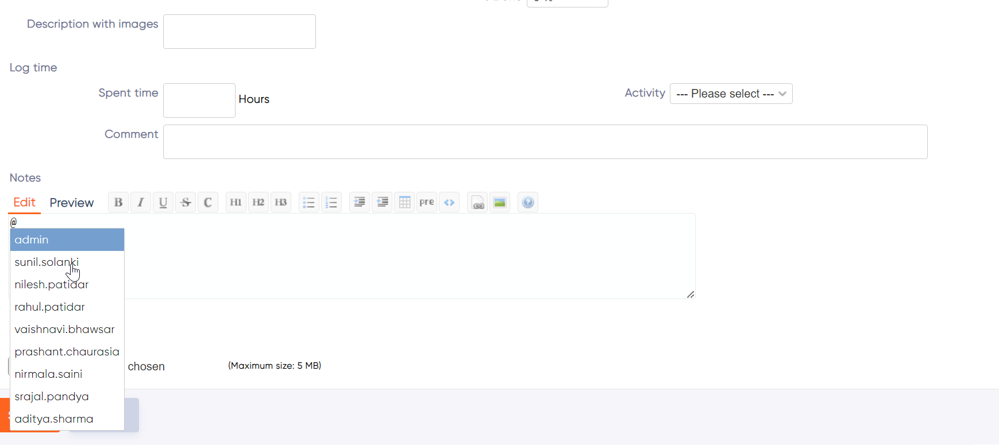
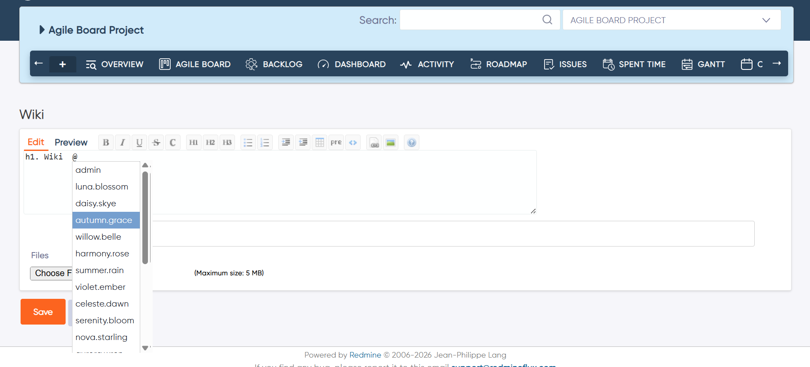
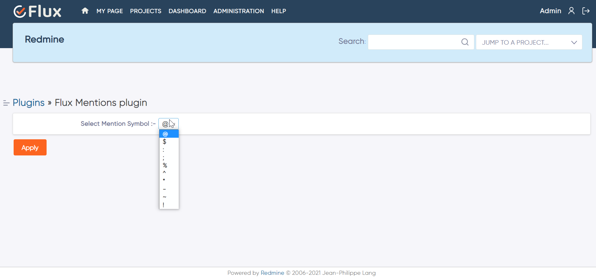

<p align="center">
  
</p>

<h1 align="center">Redmineflux Mentions Plugin</h1>

<p align="center">
  <strong>@mention team members in issues and wiki pages. Direct attention instantly — conversation stays in Redmine.</strong>
</p>

<p align="center">
  
  
  
  
  
  
</p>

<p align="center">
  <a href="https://www.redmineflux.com/product/redmine-plugins/mentions/">Website</a> ·
  <a href="https://www.redmineflux.com/knowledge-base/">Knowledge Base</a> ·
  <a href="#installation">Installation</a>
</p>

---

## Redmine Compatibility

Each Redmine major version has its own plugin release and branch. All releases have the same features.

| Redmine Version | Ruby Version | Rails Version | Plugin Version | Branch |
|-----------------|--------------|---------------|----------------|--------|
| 7.x | 3.2–4.0 | 8.1 | 7.0.0 | `master`, [`release/7.0.0`](https://github.com/zehntech/redmineflux-mentions-plugin/tree/release/7.0.0) |
| 6.x | 3.1–3.4 | 7.2 | 6.0.0 | [`release/6.0.0`](https://github.com/zehntech/redmineflux-mentions-plugin/tree/release/6.0.0) |
| 5.x | 2.7–3.2 | 6.1 | 5.0.0 | [`release/5.0.0`](https://github.com/zehntech/redmineflux-mentions-plugin/tree/release/5.0.0) |

---

## Overview

The Mentions Plugin adds @mention capability to Redmine issue comments, descriptions, and wiki pages. Type `@` followed by a username, select from the autocomplete list, and the mentioned person receives an immediate email notification — with the issue context and a direct link included.

```
Type @username → Autocomplete filters project members → Save comment → Notification sent instantly
```

Redmine has no native @mention support. Teams direct attention through Slack or email, which puts the conversation outside the issue. Decisions made in side channels never make it back into the issue thread, and the issue history stays incomplete. This plugin brings that communication back into Redmine — where it belongs.

---

## Screenshots

<!--
  SCREENSHOT GUIDELINES FOR CONTRIBUTORS:
  - Resolution: 1280 x 720 pixels (16:9 ratio)
  - Format: PNG (no JPEG — text must be crisp)
  - Browser: Use Chrome at 100% zoom, hide bookmarks bar
  - Data: Use demo data with realistic names (no "test123" or "admin")
  - Theme: Use the Redmineflux Scarlet or Daisy theme
  - Crop: Full page width, no browser chrome, no OS taskbar
  - Naming: mentions-{view-name}.png (lowercase, hyphens)
  - Location: assets/images/
-->

### @Mention Autocomplete in Issue Comment

<!-- TODO: Add screenshot — 1280x720 PNG showing the autocomplete dropdown appearing after typing @ in an issue comment field -->


*Type @ in any comment or description field to surface matching project members.*

### Wiki Page Mention

<!-- TODO: Add screenshot — 1280x720 PNG showing @mention autocomplete active inside a wiki page edit view -->


*@mentions work in wiki page content — not just issues.*

### Plugin Configuration

<!-- TODO: Add screenshot — 1280x720 PNG showing the plugin settings page with the mention symbol configuration -->


*Configure the mention symbol used to trigger autocomplete (default: @).*

---

## Features

### For Developers / Team Members
- Type `@` in any issue comment, description, or wiki page to trigger autocomplete
- Autocomplete filters to users with access to the current project only
- Multiple @mentions per comment — involve several people in one request
- @mention syntax renders inline in the saved comment so the full thread is readable
- Receive email notifications when you are mentioned anywhere in Redmine

### For Managers / Project Leads
- Direct team member attention to blocking issues without leaving Redmine
- Involve stakeholders and reviewers from within the issue — no side conversations needed
- Mentioned users are automatically added as watchers for follow-up updates
- All mentions are recorded in the issue journal — complete history preserved

### For Administrators
- Configurable mention symbol (default: `@`, changeable per instance)
- Mention autocomplete is scoped per project — no cross-project user list exposure
- Works across issues (comments, descriptions) and wiki pages
- SMTP-based notification delivery — no additional infrastructure required

---

## Tech Stack

| Component | Technology |
|-----------|-----------|
| **Backend** | Ruby on Rails (Redmine plugin) |
| **Frontend** | JavaScript (ES6), ERB templates |
| **Notification Delivery** | ActionMailer (SMTP) |
| **Database** | MySQL 5.7+ / PostgreSQL 9.6+ / SQLite 3 |
| **Auth** | Redmine native (session-based) |
| **Integration** | Redmine Hook API, Journal model patch |

---

## Installation

### Prerequisites

- Redmine 5.x (for Redmine 7.x, use the [7.0.0 release](https://github.com/zehntech/redmineflux-mentions-plugin/tree/release/7.0.0); for Redmine 6.x, the [6.0.0 release](https://github.com/zehntech/redmineflux-mentions-plugin/tree/release/6.0.0))
- Ruby 2.7+, Rails 6.1
- SMTP configured in Redmine (for notification delivery)

### Install

```bash
# 1. Copy plugin
cp -R redmineflux_mentions /path/to/redmine/plugins/

# 2. Install gems
cd /path/to/redmine
bundle install

# 3. Run migrations
bundle exec rake redmine:plugins:migrate NAME=flux_mentions RAILS_ENV=production

# 4. Restart Redmine
touch tmp/restart.txt
```

### Verify

Navigate to **Administration > Plugins** — the Redmineflux Mentions plugin should appear with version 5.0.0.

> **Note**: Version 5.0.0 is for Redmine 5.x (this `release/5.0.0` branch). For Redmine 7.x, install version 7.0.0 from the `master` or [`release/7.0.0`](https://github.com/zehntech/redmineflux-mentions-plugin/tree/release/7.0.0) branch; for Redmine 6.x, version 6.0.0 from the [`release/6.0.0`](https://github.com/zehntech/redmineflux-mentions-plugin/tree/release/6.0.0) branch.

---

## Configuration

**Administration > Plugins > Redmineflux Mentions > Configure**

### General

| Setting | Values | Default | Description |
|---------|--------|---------|-------------|
| `symbol` | Any string | `@` | The character sequence that triggers mention autocomplete |

### SMTP Requirement

Mention notifications are delivered via ActionMailer. Ensure Redmine's SMTP settings are configured under **Administration > Settings > Email notifications** before using the plugin. If no SMTP address is configured, mention notifications are skipped and a log entry is written instead.

---

## Permissions

| Permission | Description | Recommended Roles |
|-----------|-------------|-------------------|
| `view_issues` | Required to view issues where mentions appear | All members |
| `add_issue_notes` | Required to post comments containing @mentions | Developer, Engineer, PM |
| `edit_wiki_pages` | Required to use @mentions in wiki content | All members with wiki access |

> Mention autocomplete is limited to users with access to the current project. No additional permissions are required beyond standard Redmine issue and wiki permissions.

---

## FAQ

**Which Redmine versions are supported?**
Redmine 5.x, with version 5.0.0 (this [`release/5.0.0`](https://github.com/zehntech/redmineflux-mentions-plugin/tree/release/5.0.0) branch). For Redmine 7.x, use version 7.0.0 from the `master` or [`release/7.0.0`](https://github.com/zehntech/redmineflux-mentions-plugin/tree/release/7.0.0) branch; for Redmine 6.x, version 6.0.0 from the [`release/6.0.0`](https://github.com/zehntech/redmineflux-mentions-plugin/tree/release/6.0.0) branch. All releases have the same features.

**Can I @mention someone who is not a watcher on the issue?**
Yes. You can @mention any Redmine user who has access to the current project, regardless of watcher status. The mention triggers an immediate notification and automatically adds them to the issue's notification list for follow-up updates.

**Do mentioned users get added as watchers automatically?**
Yes, by default. When a user is @mentioned in an issue, they are added as a watcher so they continue to receive updates.

**Are mentions visible to all issue viewers?**
Yes. Mention syntax in a comment is visible to anyone who can view the issue. The @username appears inline in the rendered comment and is recorded in the issue journal. There is no private mention capability — all mentions are part of the issue's project-visible record.

**Does it work in wiki pages?**
Yes. The plugin hooks into both issue forms and the base wiki layout, so @mention autocomplete is available when editing wiki pages as well as issue comments and descriptions.

**What happens if SMTP is not configured?**
The plugin checks for a valid SMTP address before attempting delivery. If SMTP is not configured, notifications are skipped silently and a log entry is written to the Rails log. No errors are raised.

**Can I change the @ symbol to something else?**
Yes. The mention symbol is configurable from the plugin settings page under **Administration > Plugins > Redmineflux Mentions > Configure**. The configured symbol replaces `@` as the trigger character for autocomplete.

---

## Known Limitations

- **No in-app notification badge** — Mention alerts are delivered by email only. There is no persistent in-app notification counter or mention inbox within Redmine's UI.
- **No offline mode** — Mentions require an active server connection. There is no queue or retry mechanism if the server is unreachable when a comment is saved.
- **SMTP required for notifications** — The plugin does not support push notifications, webhooks, or alternative delivery channels. Email via SMTP is the only notification method.
- **No private mentions** — All @mentions in issue comments and wiki pages are visible to anyone who can view that content. There is no way to send a private or direct mention.
- **Autocomplete matches on login name** — The autocomplete dropdown matches against Redmine login names, not display names. Users must type the login name after `@` for correct matching.
- **No mention analytics** — There is no report or dashboard showing mention activity, frequency, or response rates.

---

## Release Notes

### v5.0.0 — 2026-11-03

**Compatibility**
- Release for Redmine 5.x (Rails 6.1, Ruby 2.7–3.2). Versions 7.0.0 and 6.0.0, with the same features, are published for Redmine 7.x on `master` and the `release/7.0.0` branch, and for Redmine 6.x on the `release/6.0.0` branch.
- Version numbers now follow the Redmine major version they're built for.

**Upgrade notes**
- If you run plugin 6.0.0 (which covered Redmine 4.x–6.x) on Redmine 5.x, replace it with 5.0.0 from this branch and restart Redmine. The plugin has no database migrations.

**Features**
- @mention autocomplete in issue comments, descriptions, and wiki pages
- Autocomplete scoped to project members — no cross-project user list exposure
- Email notification on mention with issue context and direct link
- Configurable mention symbol (default: `@`)
- Automatic watcher addition for mentioned users
- Mention recorded in issue journal for full history

**Bug Fixes**
- `#issue`, `r123`, wiki and other Redmine link syntax renders as links again in text that contains mentions.
- Core Redmine's `#` (issue) and `[[` (wiki page) autocomplete works again on issue and wiki forms. With the default `@` symbol, core Redmine's own user autocomplete is used.

**Performance**
- Issue and wiki forms load the mentionable user list in a single query instead of one query per user.
- Mention notifications load only the mentioned users instead of every project member.

**Licensing**
- The whole plugin (Ruby and ERB code, JavaScript, CSS, images and documentation) is licensed under the GNU General Public License v2 – see [`LICENSE`](LICENSE) and [`LICENSING-NOTICE.txt`](LICENSING-NOTICE.txt).
- Third-party libraries keep their own licences – see [`THIRD-PARTY-NOTICES.md`](THIRD-PARTY-NOTICES.md).
- "Redmineflux" and its logo are trademarks of Zehntech Technologies Inc.

See [RELEASE_NOTES.md](RELEASE_NOTES.md) for the full list.

---

## Works With

| Plugin | How It Connects |
|--------|-----------------|
| **[Notification](https://www.redmineflux.com/product/redmine-plugins/notification/)** | Route mention alerts through custom notification channels |
| **[Checklist](https://www.redmineflux.com/product/redmine-plugins/checklist/)** | @mention reviewers in checklist step comments |
| **[Helpdesk](https://www.redmineflux.com/product/redmine-plugins/helpdesk/)** | Loop in technical team members on escalated tickets with full context |
| **[Testcase Management](https://www.redmineflux.com/product/redmine-plugins/testcase-management/)** | Mention developers directly on failing test issues |
| **[Agile Board](https://www.redmineflux.com/product/redmine-plugins/agile-board/)** | Direct team attention to blocking cards without leaving the board view |

---

## Running Tests

```bash
cd /path/to/redmine

# All tests
bundle exec rails test plugins/flux_mentions/test

# Single file
bundle exec rails test plugins/flux_mentions/test/unit/models/issue_mailer_test.rb
```

---

## Uninstall

```bash
cd /path/to/redmine

# Roll back migrations
bundle exec rake redmine:plugins:migrate NAME=flux_mentions VERSION=0 RAILS_ENV=production

# Remove plugin
rm -rf plugins/flux_mentions

# Restart
touch tmp/restart.txt
```

---

## Support

| Channel | Link |
|---------|------|
| Knowledge Base | [redmineflux.com/knowledge-base](https://www.redmineflux.com/knowledge-base/) |
| Email | support@redmineflux.com |
| Website | [redmineflux.com](https://www.redmineflux.com) |

## Licence

- The whole plugin (Ruby and ERB code, JavaScript, CSS, images and documentation) is licensed under the GNU General Public License v2 – see [`LICENSE`](LICENSE) and [`LICENSING-NOTICE.txt`](LICENSING-NOTICE.txt).
- Third-party libraries keep their own licences – see [`THIRD-PARTY-NOTICES.md`](THIRD-PARTY-NOTICES.md).
- "Redmineflux" and its logo are trademarks of Zehntech Technologies Inc.

## More from Redmineflux

This plugin is free. Redmineflux also makes paid Redmine plugins, bundles and a managed Redmine Cloud:

- **Paid plugins** – Agile Board, Gantt Chart, Timesheet, Helpdesk, Test Case Management, Invoice and more: [see all plugins and prices](https://www.redmineflux.com/redmine-plugins-pricing/)
- **Bundles** – several plugins together at a lower price: [compare bundles](https://www.redmineflux.com/redmine-plugin-combos-pricing/)
- **Managed Redmine Cloud** – Redmine with our plugins, hosted and maintained for you: [Redmineflux Cloud](https://www.redmineflux.com/cloud-redmine/)
- **AI for Redmine** – Crux Chat, Crux Agents and the MCP Server: [AI project management for Redmine](https://www.redmineflux.com/ai-project-management-for-redmine/)

**Need help?** GitHub issues are turned off for this repository. Please email
support@redmineflux.com or use the [contact page](https://www.redmineflux.com/contact-us/).
Plugin page: [Mentions plugin on redmineflux.com](https://www.redmineflux.com/product/redmine-plugins/mentions/)

---

<p align="center">
  
</p>

<p align="center">
  Redmine plugins for modern teams.<br/>
  Built by <a href="https://www.zehntech.com">Zehntech Technologies Inc.</a>
</p>

<p align="center">
  <a href="https://www.redmineflux.com">Website</a> ·
  <a href="https://www.redmineflux.com/redmine-plugin-combos-pricing/#all-plugins">All Plugins</a> ·
  <a href="https://www.redmineflux.com/about-us/">About Us</a>
</p>
